# AWS VPC Peering Project

**Student:** YOUR NAME  
**Batch:** YOUR BATCH  
**Course:** EWB Courses, AWS Architect Associate  
**Region:** Mumbai (ap-south-1)  
**Date:** 18 October 2026

## 1. Objective

Connect two private VPCs with VPC peering so that servers in each can talk over private IPv4 addresses, with one public bastion in VPC A used for administration, and prove it with real test output.

## 2. Architecture

```
Laptop --SSH--> Internet Gateway --> VPC A 10.10.0.0/16
   Public subnet  10.10.1.0/24  Bastion 10.10.1.10 (public IP)
   Private subnet 10.10.2.0/24  App-A   10.10.2.10
                                  |
                         VPC peering (pcx)
                                  |
VPC B 10.20.0.0/16 (no IGW)
   Private subnet 10.20.1.0/24  App-B   10.20.1.10
```

## 3. Resource inventory

| Resource | Name | ID / value |
|---|---|---|
| VPC A | ewb-vpc-a | vpc-07a650500341cfab0 / 10.10.0.0/16 |
| VPC B | ewb-vpc-b | vpc-00a1d195781f33d1b / 10.20.0.0/16 |
| Public subnet A | ewb-a-public | subnet-01586c4b835d33dcb / 10.10.1.0/24 |
| Private subnet A | ewb-a-private | subnet-03a5925abc22b3ac1 / 10.10.2.0/24 |
| Private subnet B | ewb-b-private | 10.20.1.0/24 (add subnet ID) |
| Internet gateway | ewb-igw-a | igw-05ce97cc2b990c2f3 (attached to VPC A) |
| Route table (public A) | ewb-rt-a-public | rtb-02da1cfe24a519fb9 |
| Route table (private A) | ewb-rt-a-private | rtb-0b3808eeb70ff0a66 (see Observations) |
| Route table (private B) | ewb-rt-b-private | rtb-0329c3d89c144ec76 |
| Peering connection | ewb-a-b-peer | pcx-0d3b2c49609664378 |
| Bastion | ewb-bastion | 10.10.1.10 / public 3.111.245.118 |
| App-A | ewb-app-a | 10.10.2.10 / no public IP |
| App-B | ewb-app-b | 10.20.1.10 / no public IP |
| Region | Mumbai | ap-south-1 (AZ ap-south-1a) |


## 4. VPC A, subnets and internet gateway

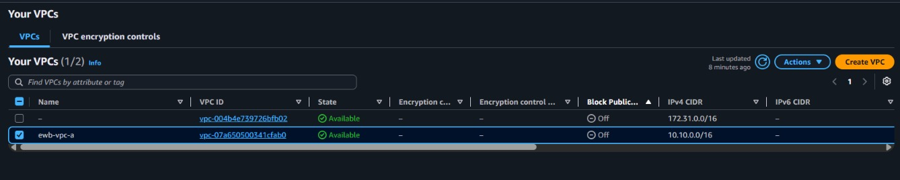

*ewb-vpc-a (10.10.0.0/16) in the Your VPCs list*

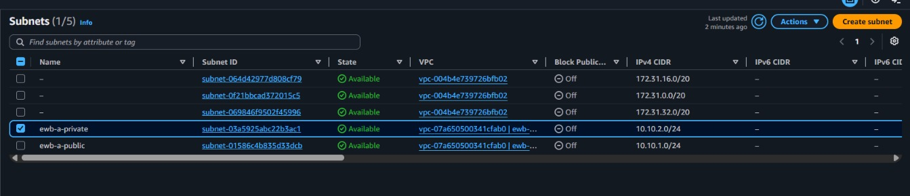

*ewb-a-public (10.10.1.0/24) and ewb-a-private (10.10.2.0/24)*

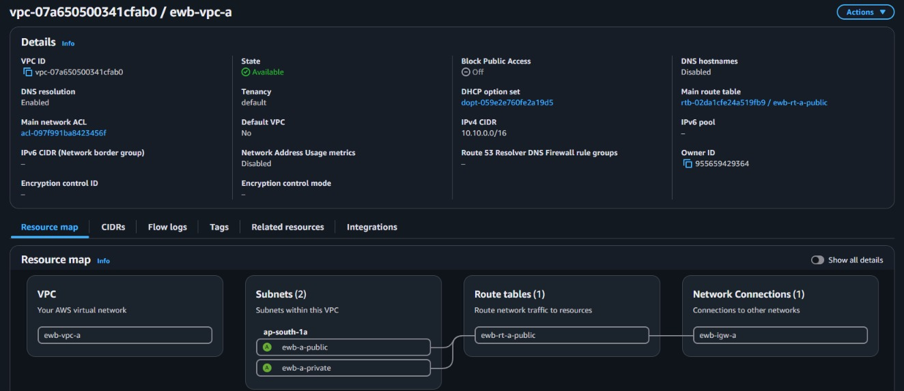

*VPC A resource map: two subnets in ap-south-1a, route table and ewb-igw-a*

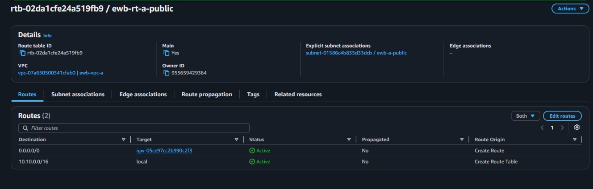

*ewb-rt-a-public: 0.0.0.0/0 to igw-05ce97cc2b990c2f3 plus the local route*

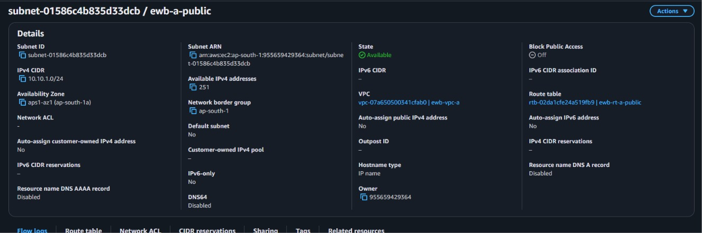

*ewb-a-public subnet details, associated with ewb-rt-a-public*

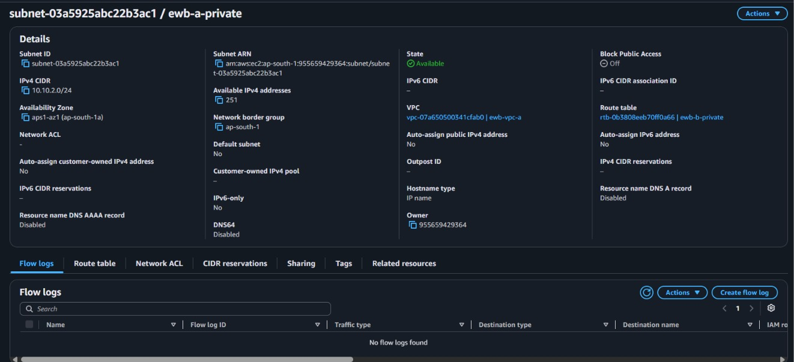

*ewb-a-private subnet details, auto-assign public IPv4 = No, own route table*


## 5. VPC B

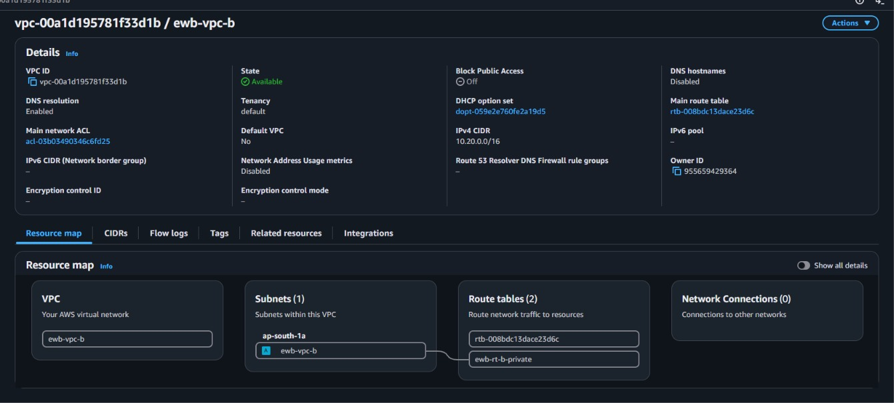

*VPC B (10.20.0.0/16): one subnet, custom route table, no network connections (no IGW)*


## 6. Route tables

| Route table | Destination | Target | Purpose |
|---|---|---|---|
| ewb-rt-a-public | 10.10.0.0/16 | local | Bastion to App-A |
| ewb-rt-a-public | 0.0.0.0/0 | igw-05ce97cc2b990c2f3 | Bastion internet access |
| ewb-rt-a-public | 10.20.0.0/16 | pcx-0d3b2c49609664378 | Bastion SSH to App-B |
| ewb-rt-a-private | 10.10.0.0/16 | local | Inside VPC A |
| ewb-rt-a-private | 10.20.0.0/16 | pcx-0d3b2c49609664378 | App-A to VPC B |
| ewb-rt-b-private | 10.20.0.0/16 | local | Inside VPC B |
| ewb-rt-b-private | 10.10.0.0/16 | pcx-0d3b2c49609664378 | Return path to VPC A |

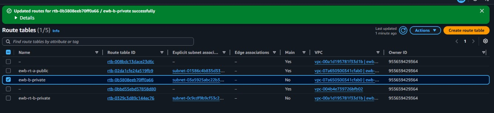

*Route tables list after updating routes*

> TODO: add screenshots of the Routes and Subnet associations tabs for ewb-rt-a-private and ewb-rt-b-private.


## 7. Security groups

| Security group | Type / port | Source |
|---|---|---|
| ewb-sg-bastion | SSH / 22 | Student public IPv4 /32 |
| ewb-sg-app-a | SSH / 22 | 10.10.1.10/32 (bastion) |
| ewb-sg-app-a | ICMP Echo request | 10.20.1.10/32 (App-B) |
| ewb-sg-app-b | SSH / 22 | 10.10.1.10/32 (bastion) |
| ewb-sg-app-b | ICMP Echo request | 10.10.2.10/32 (App-A) |

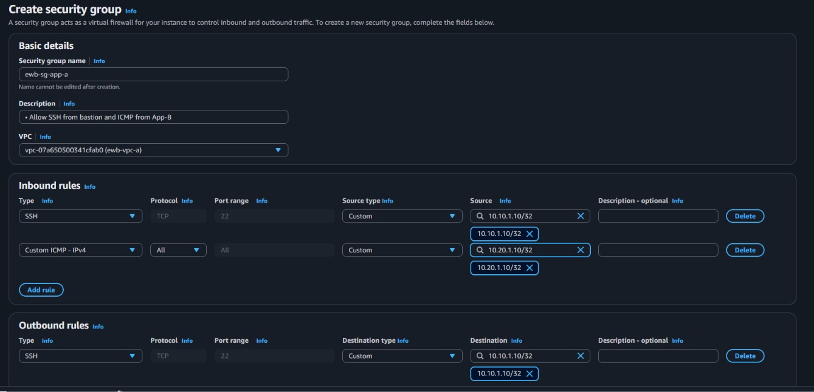

*Creating ewb-sg-app-a: SSH and ICMP from specific /32 sources*

> TODO: add screenshots of the inbound rules of ewb-sg-bastion, ewb-sg-app-a and ewb-sg-app-b.


## 8. Instances

> TODO: add screenshot of the three instances with IDs, private IPs, the bastion public IP, and no public IPv4 on App-A and App-B.


## 9. SSH access

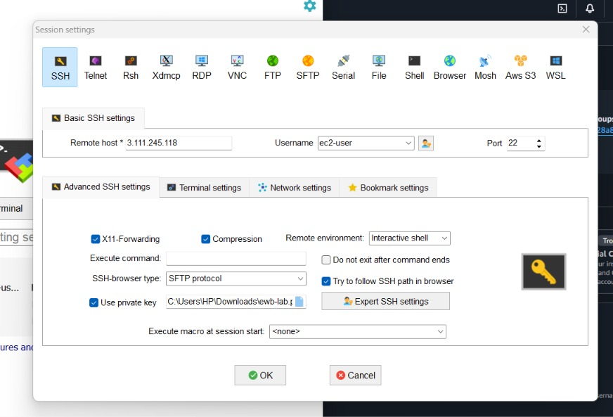

*SSH client session to the bastion using the ewb-lab key (key file stays on the laptop)*

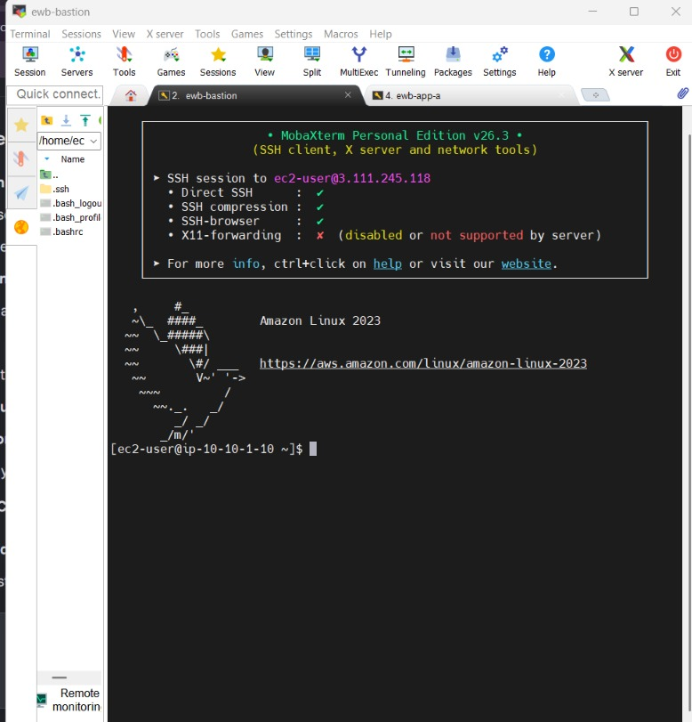

*Test: SSH to ewb-bastion succeeds (host ip-10-10-1-10)*


## 10. Peering connection

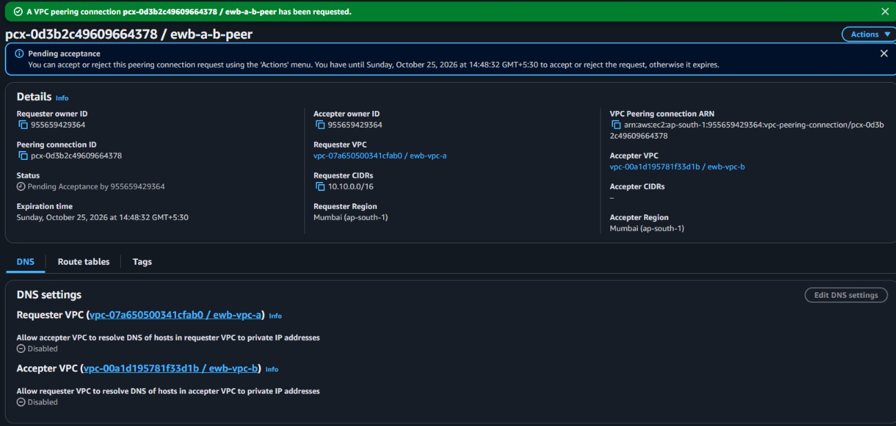

*Peering request ewb-a-b-peer created, status Pending Acceptance*

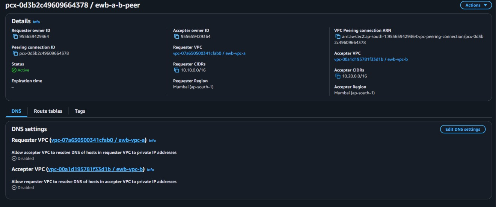

*Peering accepted: status Active, VPC A 10.10.0.0/16 to VPC B 10.20.0.0/16, Mumbai*


## 11. Tests

| Test | Where / command | Result |
|---|---|---|
| 01 Baseline | App-A: ping -c 4 10.20.1.10 (before peering) | 4 sent, 0 received, 100% loss |
| 02 Forward | App-A: ping -c 4 10.20.1.10 (after routes) | 4 received, 0% loss, ~0.29 ms avg |
| 03 Reverse | App-B: ping -c 4 10.10.2.10 | 4 received, 0% loss, ~0.22 ms avg |
| 04 Private SSH | Laptop: ssh to App-B via bastion | Shell on ip-10-20-1-10 |
| 05 Isolation | EC2 console: App-A / App-B | TODO: add screenshot (no public IPv4) |
| 06 Controlled failure | Remove ICMP rule on ewb-sg-app-b | TODO: add before / after / restored output |

### Baseline (before peering)

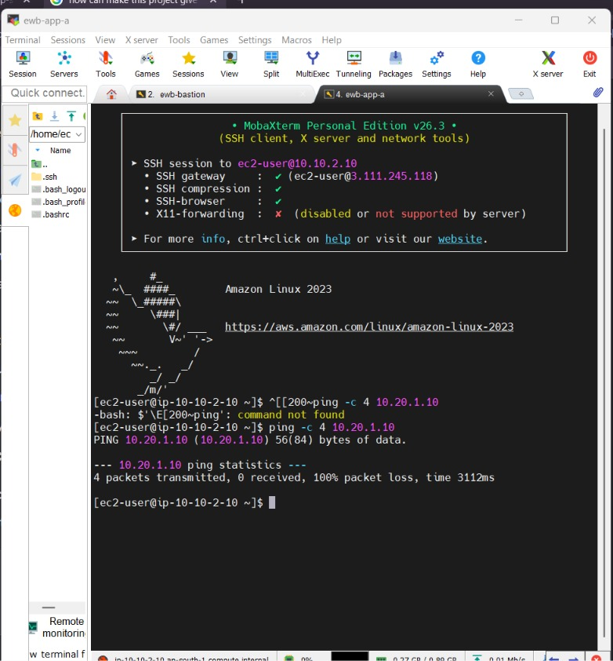

*Test 01 Baseline, App-A before peering: ping 10.20.1.10 gives 100% packet loss*

### Forward path (after peering and routes)

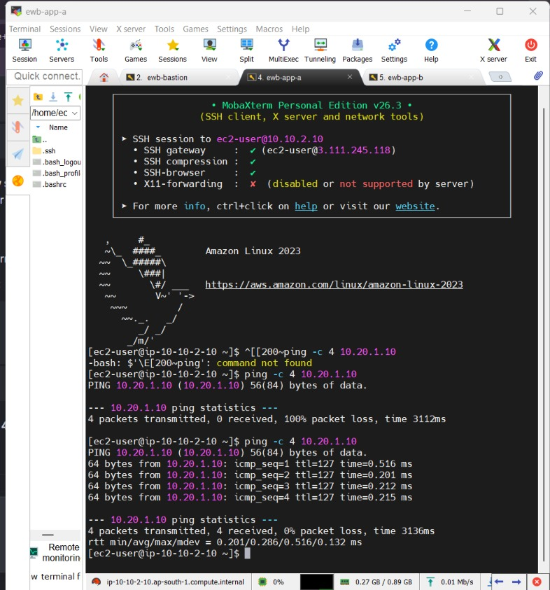

*Test 02 Forward path, App-A to App-B: baseline loss, then 4 received, 0% loss*

### Reverse path and private SSH to App-B

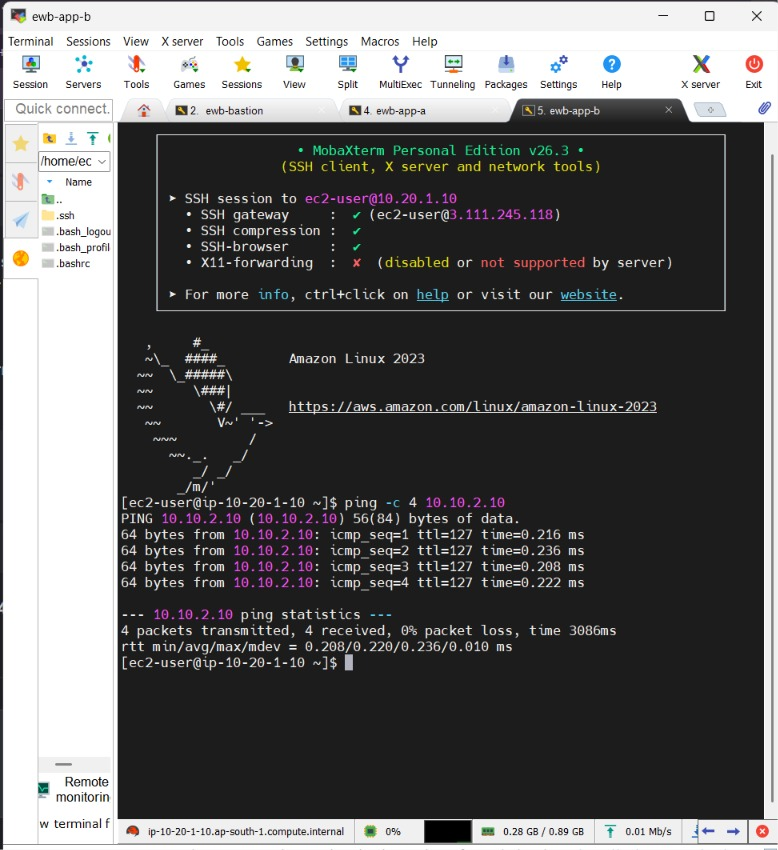

*Test 03/04 Reverse path: shell on App-B via bastion; ping 10.10.2.10 gives 0% loss*

### Controlled failure and recovery

> TODO: remove only the ICMP Echo rule from ewb-sg-app-b, ping from App-A (should fail), restore the exact rule, ping again (should work). Add all three screenshots.


## 12. Explanation

### Forward path
App-A (10.10.2.10) sends a packet to 10.20.1.10. The route table of ewb-a-private matches 10.20.0.0/16 and sends it to the peering connection pcx-0d3b2c49609664378. It arrives in VPC B, and the ewb-sg-app-b security group accepts ICMP echo request from 10.10.2.10/32.

### Return path
App-B replies to 10.10.2.10. The route table of ewb-b-private matches 10.10.0.0/16 and sends the reply back through the same peering connection. Security groups are stateful, so the reply is allowed automatically. Without this return route the request would arrive but the reply would be lost.

### Bastion and ProxyJump
The laptop connects to the bastion's public IP through the internet gateway. The bastion then opens a new SSH connection to the private server, so App-B sees the bastion's private IP 10.10.1.10 as the SSH source. The private key never leaves the laptop. The public subnet needs a 10.20.0.0/16 route to the peering connection because the bastion starts that connection.

## 13. Observations

- Active peering alone did not make ping work. The ping to 10.20.1.10 failed (100% loss) until the routes were added on both sides, then succeeded in both directions.
- Route table naming: the private route table of VPC A (rtb-0b3808eeb70ff0a66) is named ewb-b-private in the console but belongs to VPC A. Rename it to ewb-rt-a-private so names match the workbook.
- The VPC B subnet appears as ewb-vpc-b in the resource map. It should be named ewb-b-private.
- ewb-rt-a-public is also the main route table of VPC A. Any new subnet without an explicit association would become public. Consider making the private table the main table.
- In the ewb-sg-app-a screenshot the ICMP rule uses protocol All and outbound is limited to SSH to the bastion. The workbook asks for Echo request (type 8) only and default allow-all outbound. Make sure the final rules match.


## 14. Cleanup

TODO: add screenshots after cleanup: instances terminated, volumes gone, peering and routes deleted, subnets, route tables, IGW and both VPCs deleted, and a tag filter Project = EWB-VPC-Peering showing nothing left.

## 15. What I learned

TODO: write 3 to 5 sentences in your own words. Suggested points: peering is only a link and needs routes on both sides; security groups decide whether the destination accepts traffic; the most specific route wins; peering is non-transitive so VPC B cannot use VPC A's internet gateway; keep private keys on your laptop.
